# FlightScope: Project Documentation

| | |
|---|---|
| **Assignment** | APL project 2026, Task 4: *Reverse Engineer a Result* |
| **Student** | Saiedeh Babaki |
| **Teacher** | Najmaddin |
| **Date** | October 2026 |
| **GitHub** | <https://github.com/nedababaki-pixel/flightscope-swedavia> |
| **Technologies** | Python 3.14, Flask, Requests, HTML, CSS, JavaScript, unittest, Visual Studio Code, Git and GitHub |
| **AI assistance** | Claude (Anthropic), used for code review, improvements, testing help and documentation drafts |

---

## Summary

The task was to look at a finished application and work out how it was built, then build an application that gives a similar result. The application I studied was a **Swedavia FlightInfo** flight information service, shown in a sample provided by Najmaddin.

I built **FlightScope**, a web dashboard for departures and arrivals at Swedavia's ten Swedish airports. You can choose an airport, flight type and date, search for a flight and filter by status.

- **Demo Mode works.** It uses clearly labelled example flights and needs no API key.
- **Live Mode is built but has not been tested with a real key.** It connects to the official Swedavia FlightInfo API v2, but I do not have a subscription key yet.

**How to read "who did what":** in this document, **"I"** means work I did myself. **"AI-assisted"** means work where Claude suggested or wrote changes. I reviewed those changes, ran the application and tested it myself.

---

## Phase 1: Research Phase

### 1.1 Studying the sample application

I followed the steps of the *Reverse Engineer a Result* assignment and worked backwards from the result.

**Step 1: Look at the application.** The sample showed flight information for Swedish airports: arrivals and departures with details for each flight.

**Step 2: Ask questions.**

| Question | My answer |
|---|---|
| What kind of data is this? | Structured flight data: flight number, airline, city, times, gate and status |
| Where could it come from? | A data service (API) run by the airport company, not text typed by hand |
| What could have created the screen? | A program that requests the data, converts it and shows it in a table |

**Step 3: Guess the inputs.**

| Inputs (what the user chooses) | Outputs (what the application shows) |
|---|---|
| Airport | Flight number and airline |
| Departures or arrivals | Destination or origin |
| Date | Scheduled time and changed time |
| Search text | Terminal and gate |
| | Flight status (scheduled, delayed, landed, cancelled …) |

**Step 4: Guess the process.**

1. The user chooses an airport, departures or arrivals, and a date.
2. The program asks the airport's API for that day's flights.
3. The answer is converted into a simple list, and the times are changed to Swedish time.
4. The flights are shown in a table, and search or filters hide the rows that do not match.

**Step 5: Sketch the steps.** This sketch shows the logic I expected. The final code in `swedavia_client.py` follows the same steps.

```python
def get_flights(airport, direction, date):
    # 1. Check that the airport, direction and date are valid
    # 2. Call the Swedavia API: /flightinfo/v2/{airport}/{direction}/{date}
    # 3. For each flight: read number, airline, city, times, gate, status
    # 4. Convert UTC times to Swedish time
    # 5. Return the list, sorted by time
```

**Step 6: Try building it.** This is described in Phase 2.

### 1.2 Gathering information

I used several sources and also tested things in practice:

1. **Setting up my tools.** I created the project folder and an empty `app.py` in VS Code (Figure 1). I checked that Python works (Figure 2) and installed the `requests` library (Figure 3).
2. **Testing the website directly.** I wrote a small script that downloads `www.swedavia.se`. The server answered **HTTP 403 Forbidden** (Figure 4). The public website blocks scripts, so it cannot be used as a data source.
3. **Finding the official API.** On Swedavia's developer portal I found the **FlightInfo API v2** and its official guide, *Using the FlightInfo API V2* (Figure 5). From the guide I learned:
   - the address format: `https://api.swedavia.se/flightinfo/v2/{airport}/{arrivals or departures}/{date}`
   - the key is sent in the header `Ocp-Apim-Subscription-Key`
   - data is available from 7 days back to 90 days ahead
   - all times are in UTC
   - status and gate are inside a section called `locationAndStatus`
   - the ten airport codes: ARN, BMA, GOT, MMX, LLA, UME, OSD, VBY, RNB, KRN
4. **Testing the API without a key (AI-assisted check).** The API answered **401: "Access denied due to missing subscription key"** (Figure 6). This confirmed that the address is correct and that a key is required.

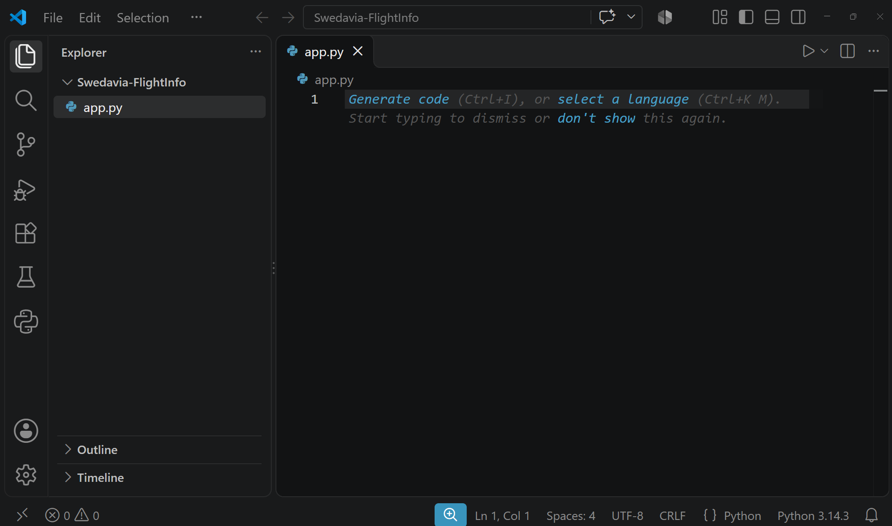 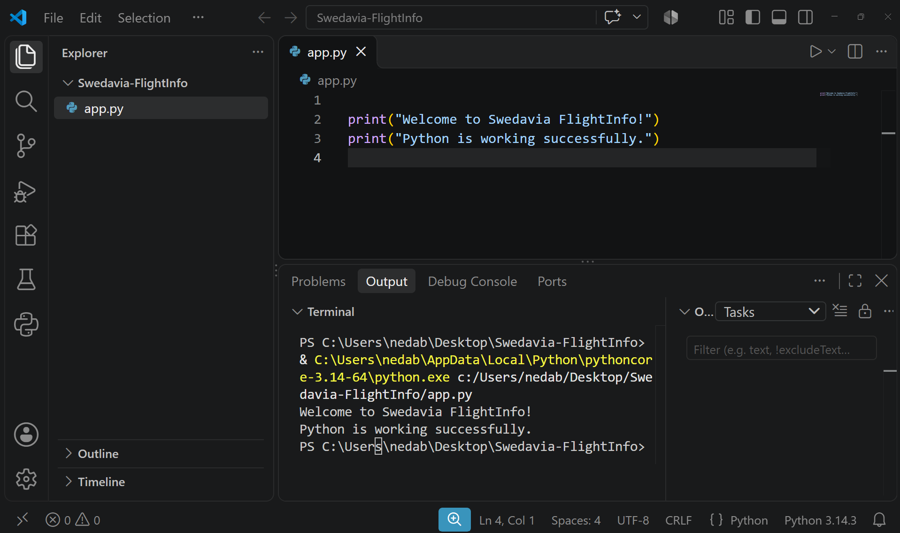

*Figure 1 (left): The start of the project, an empty `app.py` in VS Code. Figure 2 (right): My first test that Python works. Screenshots taken by me.*

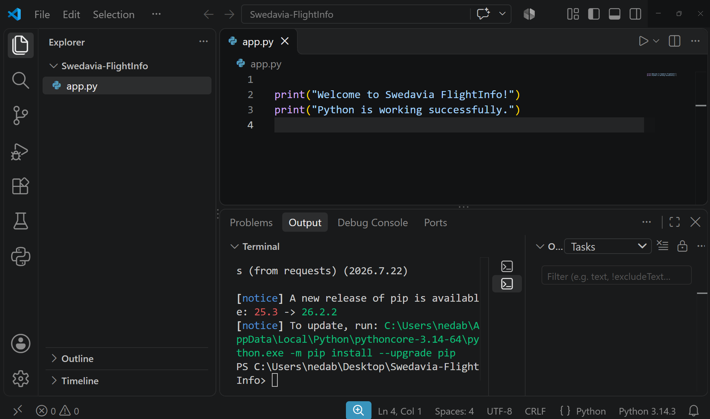

*Figure 3: Installing the `requests` library in the VS Code terminal. Screenshot taken by me.*

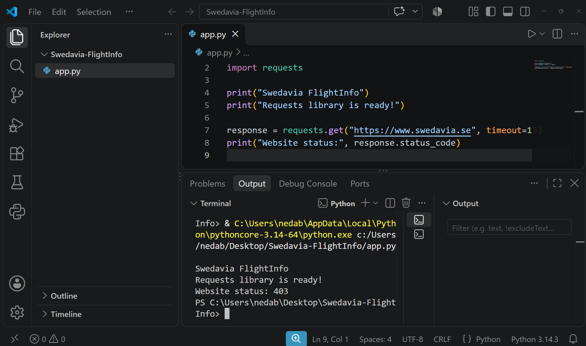

*Figure 4: My test script. Requesting www.swedavia.se returned "Website status: 403". Screenshot taken by me.*

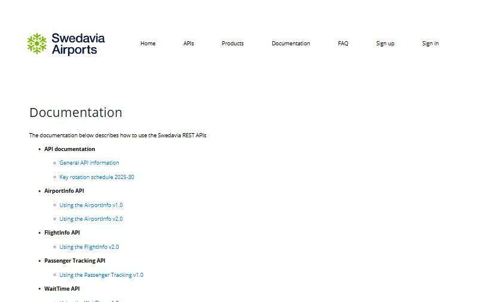

*Figure 5: The Swedavia developer portal. The FlightInfo API section links to the official guide "Using the FlightInfo v2.0". Captured with the AI assistant's built-in browser.*

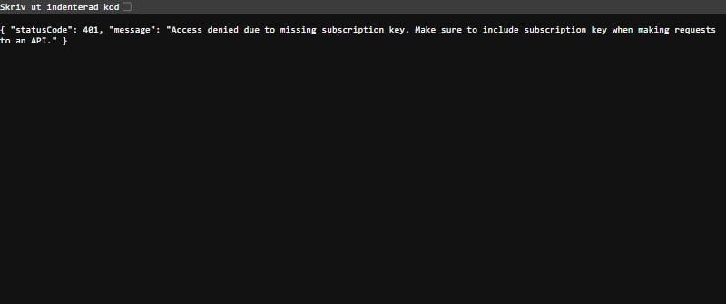

*Figure 6: The FlightInfo API called without a key answers 401, "Access denied due to missing subscription key". Captured with the AI assistant's built-in browser.*

### 1.3 Choice of tools and techniques

| Tool | Why I chose it |
|---|---|
| Python and Flask | A small, readable backend that is easy to start on Windows |
| Requests | A simple way to call an API, with a timeout |
| python-dotenv | Keeps the API key in a private `.env` file, not in the code |
| HTML, CSS, JavaScript | Runs directly in the browser; no extra build tools needed |
| unittest | Built into Python, so nothing extra to install |
| VS Code, Git, GitHub | Writing code, version control and publishing |
| Claude (generative AI) | Code review, improvements and documentation. The assignment asks us to recreate the application with GenAI. |

### 1.4 Planning the work

I divided the work into clear steps:

1. Research the sample, the data source and the API.
2. Build a first working version with Flask, a demo mode and a simple dashboard.
3. Ask an AI assistant to review the code and suggest improvements, then check them against the official documentation.
4. Test the whole solution, both automatically and by hand.
5. Publish the project on GitHub, write the documentation and record the video.

### 1.5 Problems and solutions in the research phase

| Problem | Solution |
|---|---|
| The website returned **HTTP 403**. I could not get flight data from it. | I stopped trying to read the website and looked for an official data source. I found the FlightInfo API v2. *(My own work.)* |
| The API needs a **subscription key**, and I did not have one. | I planned a **Demo Mode** with example flights, so the application can be shown without a key. *(My own decision.)* |

---

## Phase 2: Implementation

### 2.1 How the work started

I started small. First I created the project folder in VS Code, checked that Python works and installed `requests` (Figures 1–3). Then I tested the Swedavia website and the API (Figures 4 and 6).

### 2.2 The first version

My first working version had:

- one Flask file, `app.py`, with a web page and an `/api/flights` route
- a **Demo Mode** with six fixed example flights
- a planned **Live Mode** that calls the FlightInfo API with a key from `.env`
- a dashboard page with airport, flight type, date and data-source choices, search and summary numbers
- five basic automated tests
- `.gitignore` and `.env.example`, so the key is never shared

### 2.3 Improving the structure (AI-assisted)

I asked Claude to review the whole project as a senior developer, using a prompt I wrote (`CLAUDE_PROMPT.md`, kept on my computer). The review led to a cleaner structure where every file has one job:

```
app.py                Flask server: routes, input checks, security headers, error handling
swedavia_client.py    Talks to the Swedavia API, converts the data, short cache
demo_data.py          Creates example flights in the same format as the real API
templates/index.html  The web page
static/style.css      Design: dark and light themes, phone layout
static/app.js         Loads flights, search, filters, URL state
tests/test_app.py     28 automated tests
run.bat               One-click start on Windows
```

```
Browser (index.html, app.js)
     |  /api/flights?airport=ARN&direction=departures&date=...&mode=demo
     v
Flask server (app.py)          checks the input, handles errors
     |-- demo_data.py          Demo Mode: example flights
     |-- swedavia_client.py    Live Mode: calls the real API with the secret key
```

The browser never talks to Swedavia directly. Only the server knows the API key.

### 2.4 How the features were developed

- **Reading the API data (AI-assisted).** `normalize_flight` turns each flight from the API into a simple format: flight number, airline, city, times, terminal, gate and status. UTC times become Swedish time (Figure 7).
- **Status rules (AI-assisted).** Each flight gets one status: scheduled, delayed (15 minutes or more), boarding, departed, landed, cancelled or diverted. The status decides the colour and the filter.
- **Demo Mode (my idea, improved with AI).** Demo flights are now created separately for every airport, flight type and date, in the same format as the real API. Demo Mode therefore runs the same code as Live Mode.
- **Web page (AI-assisted, tested by me).**
  - airport list with all ten airports
  - departures/arrivals switch
  - date picker
  - search box
  - status filter buttons with counts
  - summary cards
  - dark and light themes
  - a phone layout
- **Starting on Windows.** `run.bat` creates a virtual environment, installs the packages and starts the server (Figure 8).

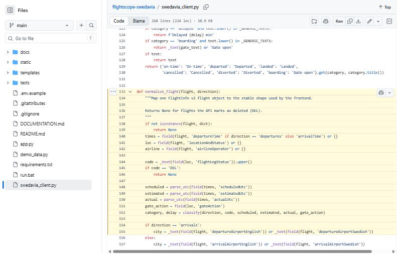

*Figure 7: `normalize_flight` in `swedavia_client.py` reads status and gate from `locationAndStatus`, as the official guide describes. The file list on the left shows the project structure. Captured with the AI assistant's built-in browser (GitHub view).*

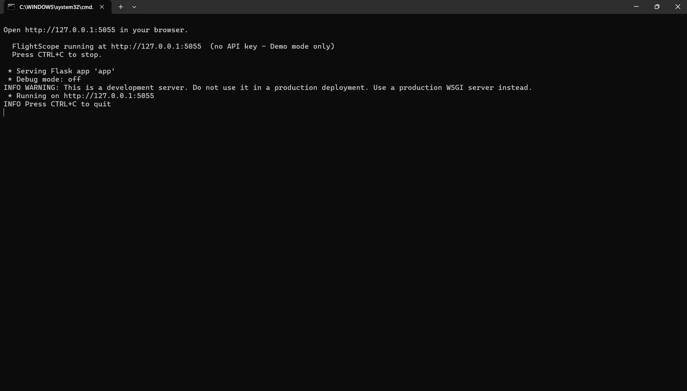

*Figure 8: FlightScope started with `run.bat` on my laptop. It runs at http://127.0.0.1:5055 in Demo Mode because no API key is configured. Screenshot taken by me.*

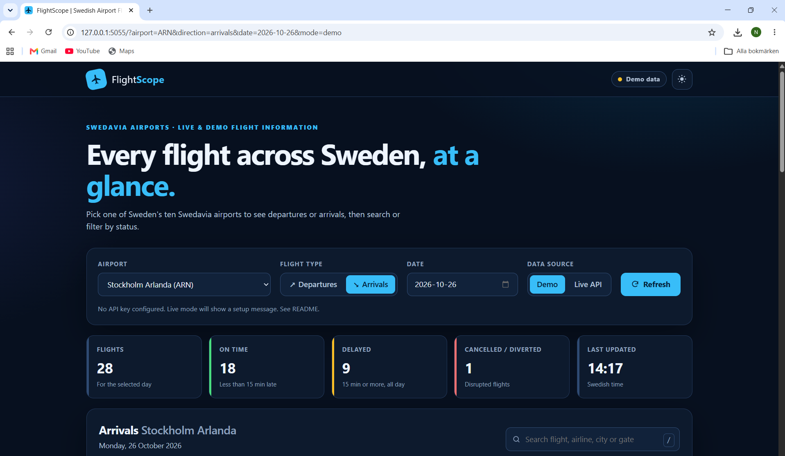

*Figure 9: The finished dashboard in dark mode (Stockholm Arlanda, arrivals, Demo Mode). Screenshot taken by me.*

### 2.5 Problems and solutions in the implementation phase

| Problem | Solution |
|---|---|
| **The technique did not work as planned:** my first version read status and gate from the wrong fields. | The AI review compared the code with the official API guide and found the correct fields in `locationAndStatus`. The code was rewritten and tests were added. *(AI-assisted.)* |
| **The code became hard to manage:** everything was in one file. | The code was split into modules with one job each (section 2.3). *(AI-assisted.)* |
| **Unexpected results:** Demo Mode showed the same six flights for every airport and date. | Demo flights are now created per airport, flight type and date. *(AI-assisted.)* |
| On Windows the app **crashed at start-up** with `No time zone found with key Europe/Stockholm`. | The `tzdata` package was added to `requirements.txt`. *(Found and fixed with AI assistance while testing on my laptop.)* |

---

## Phase 3: Completion and Improvements

### 3.1 Automated testing

I run the tests with:

```powershell
python -m unittest discover -s tests -v
```

**Result: 28 tests ran, 27 passed and 1 was skipped** (Figure 10). The skipped test only runs when a real API key exists; it checks that the key is not saved in any project file.

| Test group | What is tested |
|---|---|
| Page and security | The page loads with all ten airports; security headers; errors returned as JSON |
| Input checks | Wrong airport, wrong direction, wrong date, impossible date (30 February), dates outside the API range |
| Demo Mode | All 10 airports, both departures and arrivals; same input gives the same flights; flights sorted by time |
| Data conversion | UTC to Swedish time (winter and summer); all status types; broken data is skipped |
| Live Mode with **fake** API answers | Missing key, correct address and header, wrong key (401/403), no data (404), too many requests (429), server error, timeout, broken data |
| Repository safety | `.env` is ignored by Git; `.env.example` contains no key |

**Important:** the Live Mode tests use **fake** API answers. They show that the code handles the documented format and all error cases. They do **not** prove that Live Mode works with real Swedavia data.

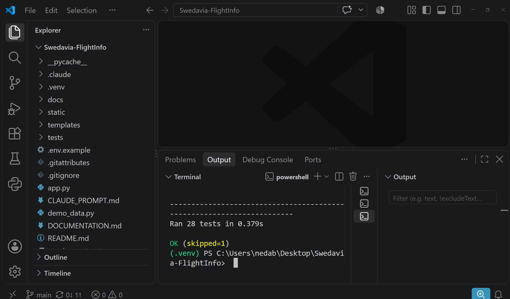

*Figure 10: The automated tests in the VS Code terminal, inside the `.venv` virtual environment: "Ran 28 tests … OK (skipped=1)". Screenshot taken by me.*

### 3.2 Manual testing

**Tested by me on my Windows laptop:**

- [x] The application starts with `run.bat` and runs (Figure 8)
- [x] Choosing a different airport loads that airport's flights
- [x] Arrivals view: the heading, the "From" column and the baggage belt column change (Figure 11)
- [x] Dark mode (Figure 9) and light theme (Figure 14)
- [x] Searching for flight **SK123** gave exactly one result (Kiruna arrivals, 26 October 2026) (Figure 12)
- [x] Statuses, delays and cancellations are shown in the table (Figure 13)

**AI-assisted checks** (done by the AI assistant in its browser and terminal):

- [x] `run.bat` on a clean installation creates the virtual environment and installs the packages
- [x] Searching for a city ("copen" shows only Copenhagen flights)
- [x] Status filter buttons show the right numbers
- [x] Live API without a key shows a clear message and a "Try again" button instead of crashing (Figure 15)
- [x] Phone size (375 px): the table becomes cards, with no sideways scrolling (Figure 16)
- [x] An invalid airport (`airport=XXX`) gives a clear error (Figure 17)

**Not tested yet:**

- [ ] **Live Mode with a real API key.** I do not have a subscription key, so Live Mode has **not** been tested with real flight data.
- [ ] Using the whole page with only the keyboard

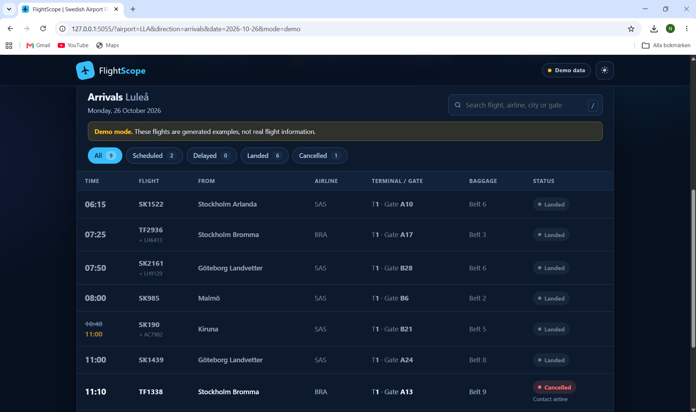

*Figure 11: Arrivals at Luleå. The table shows "From", terminal and gate, baggage belt, codeshare numbers, and a cancelled flight with a remark. Screenshot taken by me.*

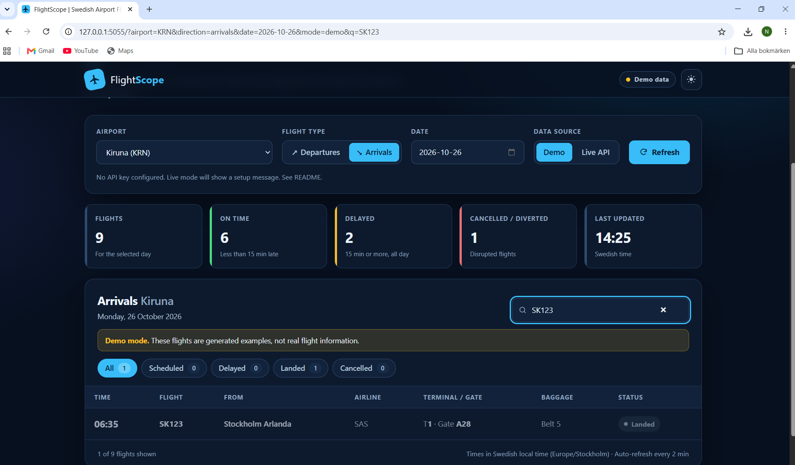

*Figure 12: Manual test: searching for SK123 at Kiruna arrivals shows exactly one flight ("1 of 9 flights shown"). Screenshot taken by me.*

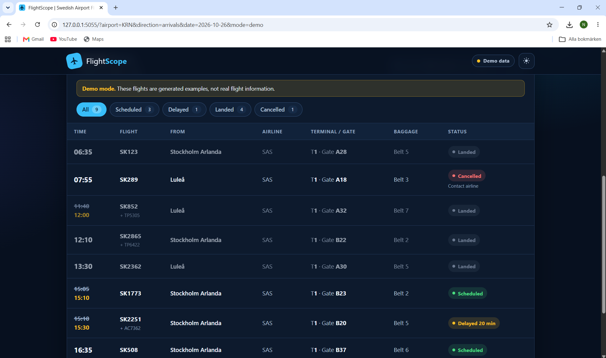

*Figure 13: Kiruna arrivals. Changed times are crossed out with the new time below. Each flight has a coloured status: Landed, Cancelled, Scheduled or "Delayed 20 min". Screenshot taken by me.*

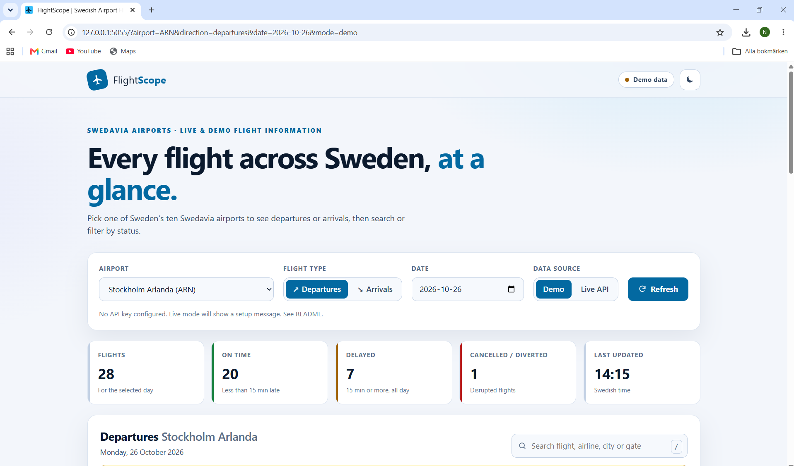

*Figure 14: The dashboard in the light theme (Stockholm Arlanda, departures). Screenshot taken by me.*

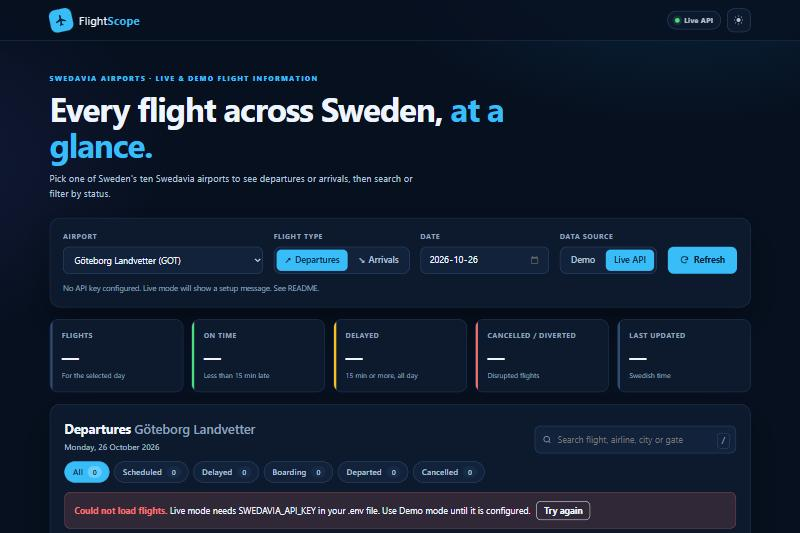

*Figure 15: Live API selected without a key. The application shows a clear message and a "Try again" button instead of crashing. Captured with the AI assistant's built-in browser.*

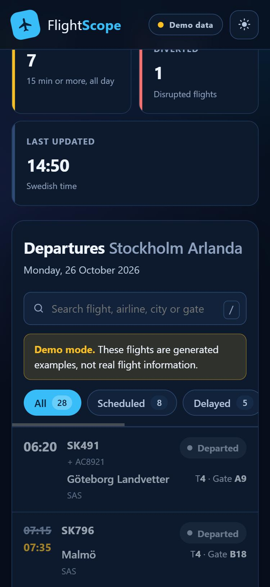

*Figure 16: Phone size (375 px). The table changes into cards. Captured with the AI assistant's built-in browser.*

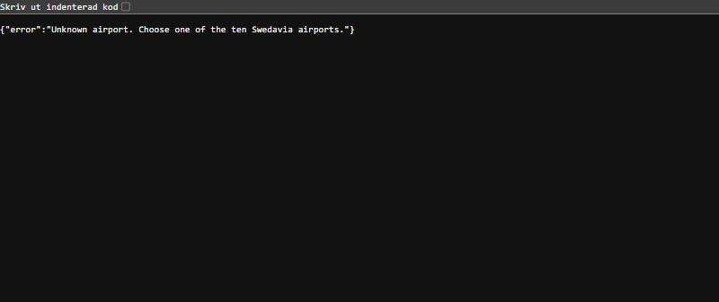

*Figure 17: Input check. `/api/flights?airport=XXX` returns the error "Unknown airport". Captured with the AI assistant's built-in browser.*

### 3.3 Improvements and optimisation

These improvements came from the AI-assisted review. I reviewed and tested them:

- **Security:**
  - the API key is only used on the server;
  - all input is checked against fixed lists;
  - security headers are set;
  - API text is shown as plain text, which prevents cross-site scripting;
  - the server only runs on my own computer, with debug mode off.
- **Reliability:** clear messages for every API error, a 15-second timeout, and a 60-second cache so the API is not called on every click.
- **Accessibility:** labels on all controls, keyboard support (`/` jumps to search), screen-reader announcements, and status shown with both text and colour.
- **Usability:** a phone layout, dark and light themes, shareable links, and automatic refresh every two minutes.

### 3.4 Publishing on GitHub

The project is published at <https://github.com/nedababaki-pixel/flightscope-swedavia> (Figure 18). The steps match the teacher's guide: `git init` (with `main` as the branch name), `git add`, `git commit`, `git remote add origin` and `git push -u origin main`. Later changes were published with `git add`, `git commit` and `git push`.

Before publishing, we checked that:

- no passwords, API keys or `.env` file are included, and `.gitignore` excludes them (Figure 19);
- the virtual environment (`.venv`) and temporary Python files are not uploaded;
- commits use my private GitHub **noreply** email address, not my personal email.

I signed in to GitHub and approved each publishing step myself. The AI assistant ran the Git commands. The commit messages describe each change, for example "Add test screenshot and finalise documentation figures".

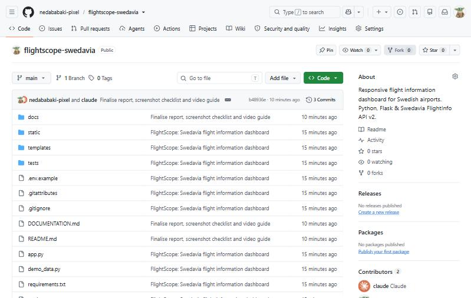

*Figure 18: The public GitHub repository with all project files. Captured with the AI assistant's built-in browser.*

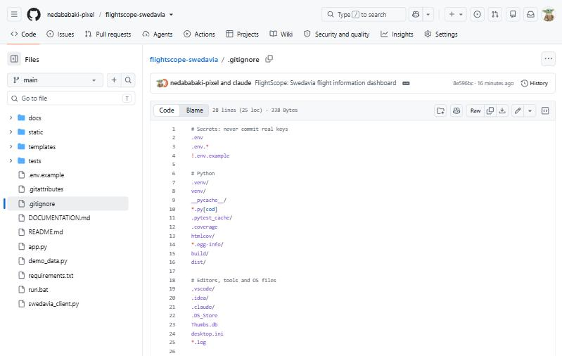

*Figure 19: `.gitignore` on GitHub. The `.env` file with the secret key, the virtual environment and temporary files are never uploaded. Captured with the AI assistant's built-in browser.*

### 3.5 Presentation

I made a 4 minute 29 second presentation video in English. It shows the project screenshots in order and has an AI-generated English voice-over. It explains the research, implementation, testing and publishing.

### 3.6 Problems and solutions in the completion phase

| Problem | Solution |
|---|---|
| **It worked during development but not on my laptop:** the Windows time-zone crash (section 2.5). | The application was tested in my real Windows environment with a fresh virtual environment, and `tzdata` was added. *(AI-assisted.)* |
| **Small bugs left at the end:** in the final check, some image descriptions in this document contained quotation marks, which could break how GitHub shows the images. | All image links were checked automatically and the descriptions were fixed before publishing. *(AI-assisted.)* |
| My **personal email** could become public in the Git history. | Email privacy is turned on in my GitHub account, and this project uses my noreply address. *(AI-assisted; I confirmed the settings in my account.)* |

---

## Phase 4: Problems and Solutions (Summary)

| # | Problem | Cause | Solution | Who solved it |
|---|---|---|---|---|
| 1 | Downloading `www.swedavia.se` returned **HTTP 403 Forbidden** (Figure 4) | The website blocks scripts; it is not an API | Used the official FlightInfo API v2 instead (Figures 5–6) | **Me** |
| 2 | **No API key** for live data | Live data needs a personal subscription | Built a clearly labelled Demo Mode. Live Mode is tested with fake API answers and shows a clear message when no key exists (Figure 15) | **Me** (Demo Mode idea and first version); **AI-assisted** (improved demo data, tests) |
| 3 | **Wrong API field mapping:** status and gate were read from the wrong place | The first version was based on guesses, not on the documentation | Compared the code with the official API guide; now reads `locationAndStatus` (Figure 7); tests added | **AI-assisted**, checked and tested by me |
| 4 | **Windows time-zone crash:** `No time zone found with key Europe/Stockholm` | Windows does not include the time-zone database that Python needs | Added the `tzdata` package to `requirements.txt` | **AI-assisted**, while testing on my laptop |
| 5 | **Same demo flights** for every airport and date | The demo data ignored the user's choices | Demo flights created per airport, direction and date | **AI-assisted** |
| 6 | **GitHub privacy:** my personal email could be published | Git saves the author's email in every commit | Email privacy turned on; commits use my GitHub noreply address | **AI-assisted**, settings confirmed by me |
| 7 | Changes to the HTML did not appear while the server was running | Flask keeps the page in memory when debug mode is off | Restart the server after changing the page (written in the README) | **AI-assisted** |

---

## Conclusion

### What I achieved

I recreated a flight information application by working backwards from a sample, following the steps of the assignment: look, ask questions, guess the inputs, guess the process, sketch the steps, and build it. The result, FlightScope, is a working dashboard for all ten Swedavia airports with search, filters, status colours, dark and light themes, and a phone layout. It is tested with 28 automated tests and published on GitHub.

**Demo Mode works.** **Live Mode has not been tested with a real subscription key.**

### What I learned

- how to work backwards from a result to its inputs, process and data source;
- how to find and read **official API documentation**, and why a website should not be scraped;
- how to keep **secrets safe**: the API key lives in `.env` and only the server uses it;
- that it is important to **check assumptions against the documentation**, because this found a real bug;
- how **automated tests with fake API answers** let me test code without internet or a key;
- how to use **Git and GitHub** safely, including email privacy;
- how to use **generative AI** as a helper, and why I must still review and test what it produces.

### What worked well

- Having Demo Mode from the start meant I could always show and test the application.
- Splitting the code into small modules made it easier to understand and test.
- Testing on my own Windows laptop found a real problem (the time-zone crash) before publishing.

### What did not go so well, and limitations

- My first version guessed the API fields instead of checking the documentation. This had to be fixed later.
- Live Mode has **not** been tested with real data, because I do not have a subscription key.
- The API expects the date in UTC, so flights just after midnight Swedish time may appear under the previous day.
- A large part of the improvements were made with AI assistance. I reviewed and tested them, but I did not write every line myself.
- Keyboard-only use has not been tested by me.

### What I could improve in the future

1. Register for a Swedavia API key and test Live Mode with real flight data.
2. Add a detail view for each flight and a Swedish language option.
3. Test the page with a screen reader and with the keyboard only.
4. Run the tests automatically on GitHub (GitHub Actions).

---

## References

- Swedavia API developer portal: <https://apideveloper.swedavia.se/>
- Swedavia, *Using the FlightInfo API V2* (PDF): <https://apideveloper.swedavia.se/content/Using_the_FlightInfo_API.pdf>
- Flask documentation: <https://flask.palletsprojects.com/>
- Requests documentation: <https://requests.readthedocs.io/>
- Najmaddin, *Guide för dokumentation, videoinspelning samt GitHub* and *4. Reverse Engineer a Result*, APL project 2026

## Related files

- `README.md`: installation and overview
- `docs/GITHUB_GUIDE.md`: how to publish safely to GitHub
- `docs/SCREENSHOT_CHECKLIST.md`: evidence and requirement checklist
- `docs/VIDEO_SCRIPT.md`: video storyboard and narration
- `docs/FlightScope_Documentation.pdf`: this document as a PDF
